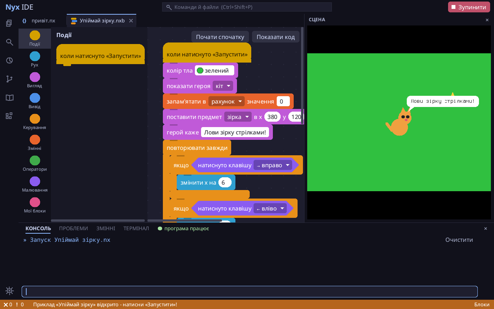
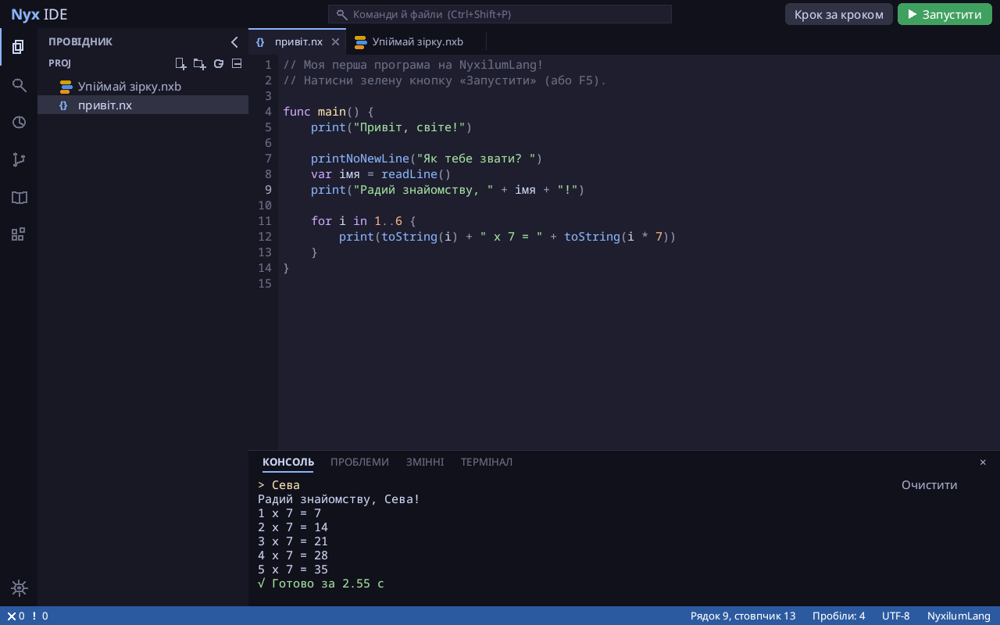
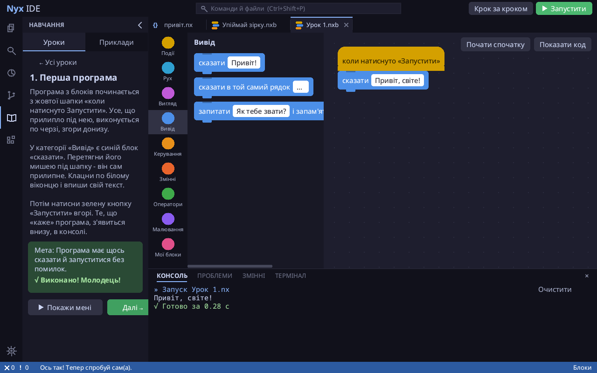
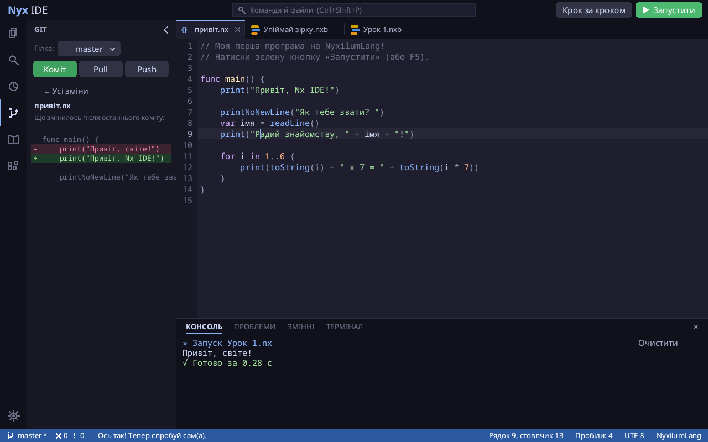
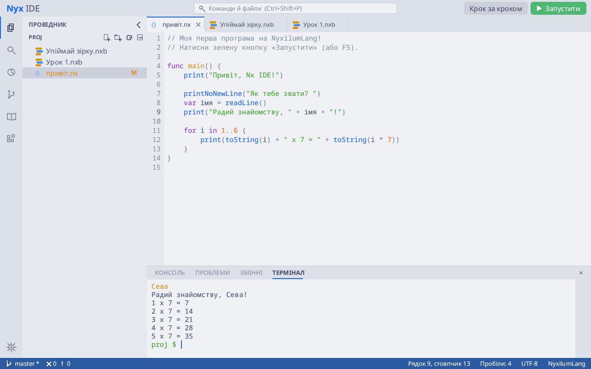

# Nx IDE

*[English](README.en.md)*

Середовище програмування для [NyxilumLang](https://github.com/Faneraiy14/NyxilumLang), написане
**на самій NyxilumLang**. Для всіх, хто починає програмувати, і для тих, хто вже вміє.

- **Блоки** - як у Scratch: герой на сцені, малювання, списки, свої блоки; код ↔ блоки.
- **Код** - як VS Code: будь-яка тека (Ctrl+O), підказки, F12/F2, заміна, згортання блоків, розділений редактор, мінікарта, «хлібні крихти», список функцій (Ctrl+Shift+O), налагоджувач, сцена для ігор.
- **Навчання** - уроки з автоперевіркою й «Покажи мені», приклади, підказки до помилок.
- **Інструменти** - справжній термінал (bash/cmd, кольори, vim), git (вибір файлів для коміту, історія), історія версій, розширення (Anylint; свої - на NyxilumLang).
- **Вигляд** - теми, згладжені шрифти, масштаб, бічна шторка; налаштування з розділами й пошуком; оновлення - кнопкою в самій IDE.

Детально - [ПОСІБНИК.md](ПОСІБНИК.md) ([English guide](GUIDE.md)).

| Блоки й сцена | Код і консоль |
|---|---|
|  |  |
| **Уроки й «Покажи мені»** | **Git** |
|  |  |
| **Термінал і світла тема** | |
|  | |

## Швидкий старт

1. Скачай інсталятор зі сторінки **[Releases](../../releases/latest)**: Windows - `NxIDE-win-x64-setup.exe`, Ubuntu - `NxIDE-linux-x64.deb`.
2. Встанови: «Далі → Готово» (Windows) або подвійний клік → «Встановити» (Ubuntu).
3. Відкрий ярлик **«Nx IDE»** → вибери «Новачок» → IDE сама проведе екскурсію й відкриє урок 1.

## Вимоги

| | |
|---|---|
| **Система** | Windows 10/11 (64-біт) або Linux x64 (Ubuntu 20.04+, Debian 11+ і подібні) з графічним робочим столом (X11 або Wayland з XWayland - як в Ubuntu типово) |
| **Пам'ять** | ~100 МБ сама IDE (+ запущені програми); комфортно - від 2 ГБ на комп'ютері |
| **Диск** | ~100 МБ (Linux), ~200 МБ (Windows) |
| **Екран** | від 1024×640; є масштаб інтерфейсу 100-200% |
| **.NET, Java, Python** | не потрібні - мова NyxilumLang уже всередині |
| **Інтернет** | лише для завантаження й оновлень |
| **Необов'язково** | `git` - для панелі Git; `php` і [Anylint](https://github.com/Faneraiy14/anylint) - для перевірки коду розширенням Anylint |

## Завантажити

Окрема програма, мова вже всередині - нічого більше ставити не треба.
Сторінка релізів: **[Releases](../../releases/latest)**.

| Система | Що качати |
|---|---|
| **Windows** | **`NxIDE-win-x64-setup.exe`** - «Далі → Готово», без адміна; ярлик «Nx IDE» на робочому столі й у «Пуск». Якщо Windows покаже «Windows захистила ваш ПК» - «Докладніше» → «Виконати все одно» (інсталятор не підписаний платним сертифікатом) |
| **Ubuntu / Debian** | **`NxIDE-linux-x64.deb`** - подвійний клік → «Встановити»; ярлик «Nx IDE» у меню, команда `nx-ide` |
| **Linux однією командою** | `curl -fsSL https://raw.githubusercontent.com/Faneraiy14/NyxilumIDE/main/install.sh \| bash` (без sudo) |
| **macOS** | поки нема: вікно IDE працює через X11 |

Оновлення - кнопка «Оновити» в самій IDE (або новий `.deb`).

Хто пише в терміналі - мова окремо, як Node.js: [NyxilumNode](https://github.com/Faneraiy14/NyxilumNode)
(там теж є IDE: `nx ide`).

## Якщо щось не працює

| Проблема | Що зробити |
|---|---|
| Windows: «Windows захистила ваш ПК» | «Докладніше» → «Виконати все одно». Інсталятор не підписаний платним сертифікатом; код відкритий - можна подивитися, що він робить |
| Антивірус скаржиться чи видаляє файл | Те саме: непідписана програма. Додай теку Nx IDE у винятки антивірусу або напиши в [Issues](../../issues) |
| Ubuntu: подвійний клік по `.deb` нічого не робить | У терміналі: `sudo apt install ./NxIDE-linux-x64.deb` |
| Ubuntu: ярлик на робочому столі не запускається | Права кнопка по ярлику → «Дозволити запуск» (Allow Launching) |
| Вікно не з'являється (Linux) | Потрібен X11 або XWayland. Перевір у терміналі `echo $DISPLAY` - має бути щось на кшталт `:0`. Запусти `nx-ide` з терміналу - буде видно помилку |
| Не друкуються українські літери | Перемкни розкладку як завжди (IDE її бачить). Якщо все одно ні - напиши в Issues, яка система й розкладка |
| Програма «зависла» (нескінченний цикл) | Червона кнопка «Зупинити» вгорі або Shift+F5 |
| «Оновити» не спрацювало | Потрібен інтернет. Якщо ставили з `.deb` - скачай новий `.deb` зі сторінки релізів |
| Anylint пише «не знайдено Anylint» | Це необов'язкове розширення: потрібні `php` і Anylint. Не треба - вимкни його в «Розширеннях» |
| Хочу почати з чистого аркуша | Видали налаштування: `~/.nyx-ide/налаштування.json` (Windows: `%USERPROFILE%\.nyx-ide\`). Програми не зачіпаються |
| IDE показала «Внутрішня помилка IDE» | Робота вже збережена. Деталі - у `~/.nyx-ide/помилки.log`; надішли їх у [Issues](../../issues) |

## Відомі обмеження

- **macOS** - поки нема: вікно IDE працює через X11, якого на Mac без XQuartz нема.
- **«Відкрити як блоки»** вміє лише прості програми: `struct`, `return`, `try/catch`, масиви з `[0]`, `for x in список`, лічильник циклу в тілі - блоками не скласти (IDE пояснить, що саме й у якому рядку).
- **Термінал** на Windows (cmd через ConPTY) перевірено менше, ніж на Linux.
- **Git** - зміни, вибір файлів для коміту, скасування змін файла, історія комітів, гілки, push/pull. Розв'язувати конфлікти - поки в терміналі або іншій програмі.
- **Редактор** - один курсор (без кількох курсорів одночасно).
- **Інтерфейс і уроки** - лише українською.
- **Windows-версію** ще мало перевіряли на справжніх комп'ютерах.

## Плани

- macOS (власне вікно без X11)
- англійська мова інтерфейсу й уроків
- більше уроків і прикладів (ігри, анімації, звук)
- спільні проєкти: ділитися програмою посиланням
- розв'язання конфліктів Git у самій IDE
- кілька курсорів у редакторі
- розширення з власними панелями й підказками
- кращий перетворювач «код → блоки»

## Ліцензія

[MIT](LICENSE) - вільно використовувати, змінювати й поширювати, зберігаючи згадку про автора.
Шрифти: Noto Sans / Noto Sans Mono і Terminus - [SIL Open Font License](https://openfontlicense.org).

## З клону цього репо

```bash
nx src/ide.nx
NX_IDE_HOME=/шлях/до/NyxilumIDE nx ide
```

## Гарячі клавіші

| Клавіші | Дія |
|---|---|
| F5 / Ctrl+R | запустити / зупинити |
| Ctrl+S | зберегти (і так зберігається перед запуском і при виході) |
| Ctrl+Z / Ctrl+Y | скасувати / повторити |
| Ctrl+C / Ctrl+X / Ctrl+V | копіювати / вирізати / вставити (без виділення - весь рядок) |
| Ctrl+A | виділити все |
| Ctrl+/ | закоментувати рядки |
| Ctrl+D | дублювати рядок |
| Tab / Shift+Tab | відступ / прибрати відступ |
| Ctrl+= / Ctrl+- / Ctrl+колесо | шрифт більший / менший |
| Ctrl+N | нова програма |
| Ctrl+O | відкрити іншу теку |
| Ctrl+P / Ctrl+Shift+P | швидко відкрити файл / усі команди |
| Ctrl+F / Ctrl+H | знайти / замінити у файлі (Tab - між полями, Ctrl+Enter - замінити всі) |
| Ctrl+Shift+F / Ctrl+Shift+H | знайти / замінити в усіх файлах |
| Alt+↑ / Alt+↓ | перенести рядок вище / нижче (з Shift - копія) |
| Ctrl+Shift+[ / Ctrl+Shift+] | згорнути / розгорнути блок `{ }` (або стрілка біля номера рядка) |
| Ctrl+B / Ctrl+J / Ctrl+` | бічна шторка / нижня панель / термінал |
| F12 / F2 | до визначення / перейменувати всюди |
| Ctrl+Shift+O | перейти до функції у файлі |

## Тести

Усі тести без вікна (сценарії, «мавпа» з випадковими діями):

```bash
bash tests/run_all.sh
```
